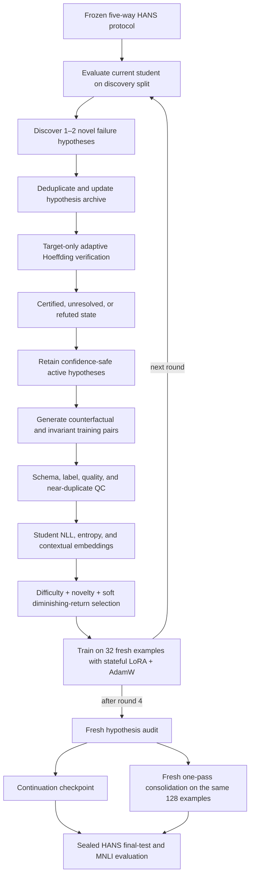

# Verified failure-driven active learning — protocol v7

This repository implements the current primary method: a checkpoint-conditioned,
closed-loop active-learning protocol for improving a Qwen3-1.7B NLI student on
HANS failure modes. A Qwen3-14B teacher discovers hypotheses, generates
verification probes and produces QC-validated intervention pairs. The final
training budget is 128 examples in four rounds of 32.

The canonical implementation is v7. Earlier v2--v6 runs are historical
ablations or diagnostics and are intentionally not described in this README.
Their complete record is retained in [Flow.md](Flow.md). Experimental results,
cost evidence and paper figures belong in
[STAGE2_OVERVIEW.md](reports/stage2_seed42_overview/STAGE2_OVERVIEW.md), not in
this flow specification.

## Scientific objective

The method does not merely select globally uncertain MNLI examples. It attempts
to identify reproducible student failure mechanisms, verify them under a
predeclared confidence rule, generate targeted training interventions, and
refresh the hypothesis state after every student update.



## Frozen data roles and leakage boundary

The HANS records are assigned once to five disjoint roles:

1. hypothesis discovery;
2. hypothesis verification context;
3. intervention-pool context;
4. gain/stopping evaluation;
5. sealed final test.

The teacher and selector never see the sealed final-test labels or predictions.
Verification probes have `training_eligible=false` and can never enter the
training set. The sealed final test is evaluated only after the acquisition
trace and final checkpoints are frozen.

Required shared artifacts are:

```text
outputs/stage2_shared/hans_frozen_manifest.json
outputs/stage2_shared/predictions.jsonl
outputs/stage2_shared/sealed_final_test.jsonl
outputs/stage2_shared/gain_eval_stopping_subset_v1.json
outputs/stage2_acquisition_ours_verified_v5/seed_42/.complete
```

The completed v5 artifact supplies the validated initial synthetic reserve; v7
then refreshes hypotheses and generates new candidates checkpoint-conditionally.

## 1. Checkpoint-conditioned failure discovery

At each refresh, the current student is re-evaluated on the discovery split.
The teacher receives discovery evidence and proposes only one or two candidate
mechanisms. Proposal count is deliberately small so that the archive evolves
incrementally rather than being replaced by a large new hypothesis batch.

Candidates are rejected when they are near-duplicates of an archived mechanism.
Previously resolved mechanisms remain in the archive and can be reactivated if
the same failure returns after a later student update. At most five hypotheses
are active in a refresh.

Discovery-error ranking is gold-blind in the closed loop. The final-test role is
never materialized for the teacher.

## 2. Target-only adaptive verification

Verification tests whether a candidate describes a reproducible student failure,
not whether an intervention will necessarily improve downstream accuracy.

For hypothesis `h` and target probe `i`, define

```text
Z_(h,i) = 1  if the student predicts the predeclared wrong binary HANS label,
          0  otherwise.

nu_hat_h(n) = (1/n) Σ_i Z_(h,i).
```

The target-failure threshold is `tau_v = 0.5`. With the union-adjusted Hoeffding
radius `r_h(n)`, the decision interval is

```text
LCB_h(n) = nu_hat_h(n) - r_h(n),
UCB_h(n) = min(1, nu_hat_h(n) + r_h(n)).
```

The adaptive look schedule begins at 20 valid target probes and adds 10 when the
interval is unresolved. The state transition is predeclared:

- `LCB_h >= tau_v`: certify the failure mechanism;
- `UCB_h < tau_v`: refute/resolve the mechanism;
- otherwise: retain it as unresolved when more evidence is not available.

This is confidence-safe retention: a plausible hypothesis is not discarded only
because the finite verification sample has insufficient power. V7 verification
is target-only. Counterfactual and invariant controls are generated later as
training interventions and are not part of the certification statistic.

## 3. Intervention generation and QC

For every retained hypothesis, the teacher generates complete synthetic pairs:

- a counterfactual pair changes the feature associated with the failure while
  preserving unrelated content;
- an invariant pair changes irrelevant content while preserving the intended
  NLI relationship.

Generation is separate from verification. Verification examples are never
copied into the training reserve.

Every generated item must pass:

- the versioned pair schema;
- exact three-class NLI label validation;
- sentence-length and structural checks;
- pair-member and context distinctness checks;
- near-duplicate rejection against the existing pool;
- teacher QC with bounded retries.

The selector operates on complete two-example pairs, so an intervention pair is
never split across selected and unselected data.

## 4. Student-conditioned acquisition

The current student scores every eligible pair before selection. For the target
member of pair `j`, difficulty is

```text
D_j = 0.65 R_NLL(j) + 0.35 R_entropy(j),
```

where `R` is the tie-aware percentile rank within the current candidate pool.
NLL measures low probability on the validated gold label; predictive entropy
measures uncertainty across the three normalized NLI label probabilities.

Contextual embeddings from the current student provide a novelty score relative
to pairs already selected. The greedy pair score is

```text
S_j = D_j
      + 0.50 R_novelty(j)
      + 0.35 [sqrt(m_h + 1) - sqrt(m_h)]
      + 0.50 / (1 + m_h),
```

where `m_h` is the cumulative number of selected pairs for hypothesis `h`.
The last two terms provide soft diminishing returns and a temporary bonus for a
new or under-trained hypothesis. They encourage coverage without imposing a
hard per-hypothesis quota.

Each round selects 16 complete pairs, giving 32 fresh training examples. The
maximum trace contains four rounds and 128 unique examples.

## 5. Stateful closed-loop training

Let `A_r` be the LoRA adapter and `O_r` the complete AdamW state after round
`r`. Stateful continuation applies

```text
(A_(r-1), O_(r-1)) --32 fresh examples--> (A_r, O_r).
```

With batch size 4, gradient accumulation 8 and one epoch, each round produces
eight microbatches and exactly one optimizer step. The required optimizer chain
is

```text
0 -> 1 -> 2 -> 3 -> 4.
```

Before every round after the first, the serialized parent adapter is compared
tensor-by-tensor with the adapter loaded in memory. Keys and shapes must match,
and numerical differences must remain inside the dtype tolerance. Ordered
trainable-parameter names and the AdamW step counter are also audited. Any
continuity failure terminates the run instead of silently producing an invalid
checkpoint.

After each update, the new checkpoint drives the next discovery, verification,
generation and selection refresh.

## 6. One acquisition trace, two fair final branches

V7 executes the teacher-driven closed loop only once. Both final branches use
exactly the same hypothesis archive, generated pool, acquisition order and 128
selected example IDs.

### Stateful continuation

The online branch returns `(A_4, O_4)` after carrying LoRA weights and AdamW
moments through all four rounds. It measures the complete online learning
process.

### Fresh consolidation

After acquisition is frozen, the consolidation branch reloads the original base
checkpoint, initializes a fresh LoRA adapter with the same seed, and trains once
on the union

```text
D_128 = B_1 union B_2 union B_3 union B_4.
```

Both branches see each selected example once, use CE, and perform four total
optimizer steps. Consolidation is the controlled one-pass acquisition comparison;
continuation measures the additional effect of online stateful optimization.

## Models and primary configuration

| Role | Configuration |
|---|---|
| Teacher | `Qwen/Qwen3-14B`, bfloat16 |
| Student | `Qwen/Qwen3-1.7B` with LoRA |
| Seed | 42 |
| Maximum budget | 128 examples |
| Rounds | 4 |
| Per round | 32 examples = 16 complete pairs |
| Verification | target failure, `tau_v=0.5`, adaptive Hoeffding |
| Objective | per-example causal-LM cross-entropy |
| Final evaluation | sealed HANS final test plus MNLI matched/mismatched |

Resolved configuration:

```text
configs/stage2_ours_verified_v7_dual_closed_loop.yaml
```

## Setup and run

```bash
conda activate active_lr
cd /home/llm/hainn/hainn/active_learning
python -m pip install -r requirements.txt
```

V7 requires two distinct GPUs. The teacher and student GPU numbers below are
physical device IDs:

```bash
TEACHER_GPU=1 STUDENT_GPU=0 \
./run_ours_verified_v7_dual_closed_loop.sh
```

If a valid incomplete run exists, resume it without repeating completed teacher
work:

```bash
TEACHER_GPU=1 STUDENT_GPU=0 \
./run_ours_verified_v7_dual_closed_loop.sh --resume
```

Do not use overwrite merely to recover from an interruption. The launcher
validates completed-round artifacts before resuming.

## Canonical artifacts

```text
outputs/stage2_runs_ours_verified_v7_dual/
└── experiment_b/ours_verified/budget_128/seed_42/
    ├── rounds.jsonl
    ├── selected_training_examples.jsonl
    ├── branches/
    │   ├── continuation/result.json
    │   └── consolidation/result.json
    ├── comparison.json
    ├── V7_COMPARISON.md
    └── .complete
```

The consolidated professor/paper report is
[STAGE2_OVERVIEW.md](reports/stage2_seed42_overview/STAGE2_OVERVIEW.md). Rebuild
its tables and SVG figures after new experiments complete with:

```bash
python scripts/report_stage2_overview.py
```

## Validation

Run the repository tests with:

```bash
python -m pytest -q
```

The full mathematical derivation, protocol evolution, incident ledger and
historical ablations remain in [Flow.md](Flow.md). Published baseline
implementations are documented separately in
[src/baselines/literature/README.md](src/baselines/literature/README.md).
