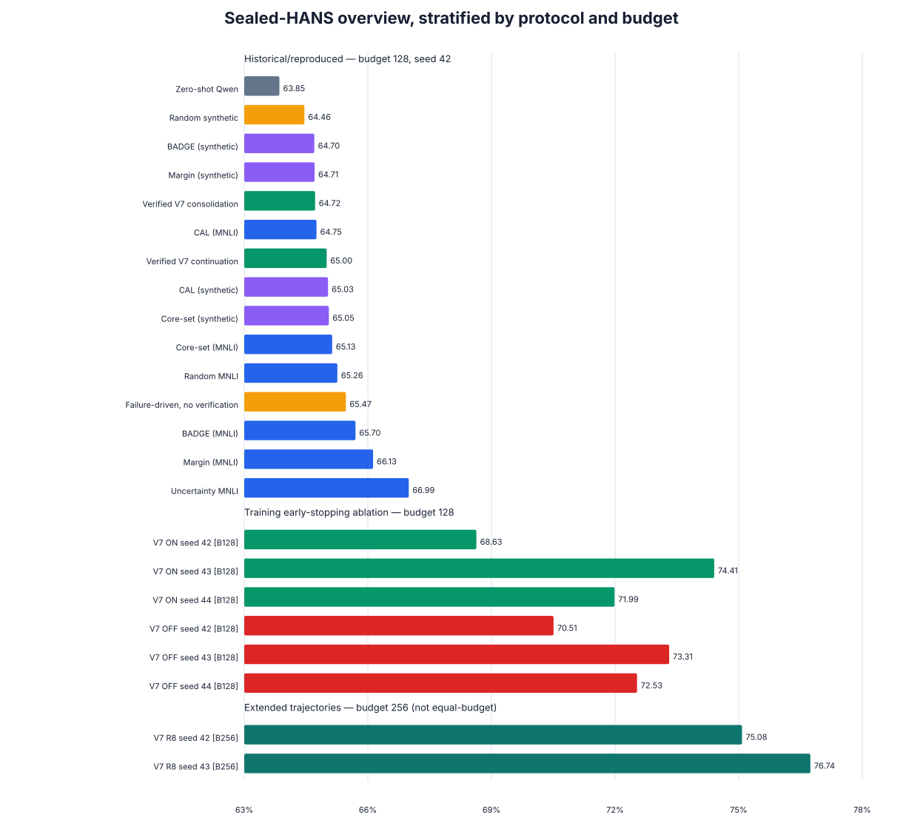
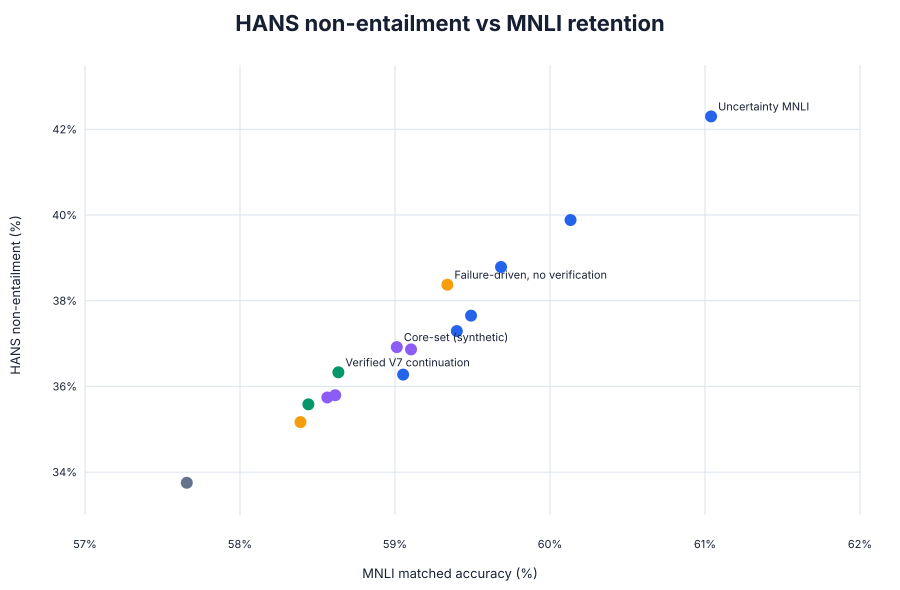
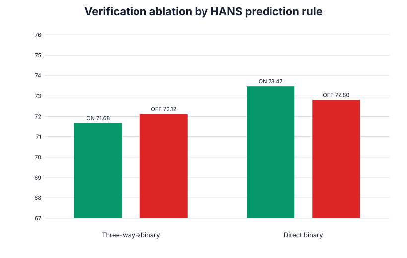
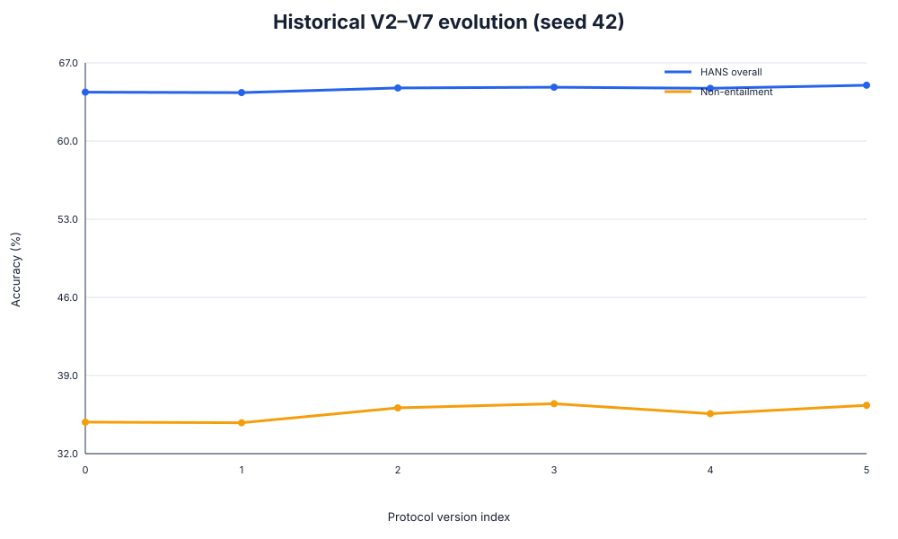
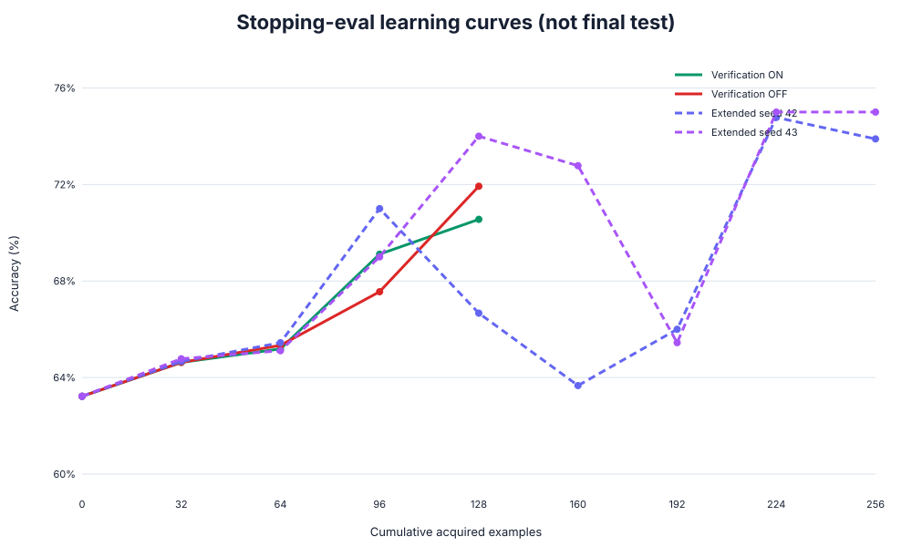
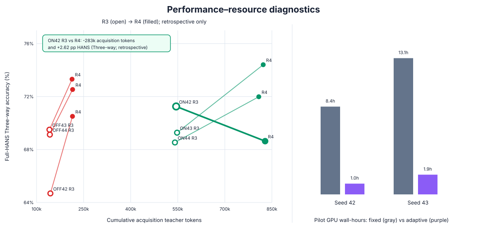
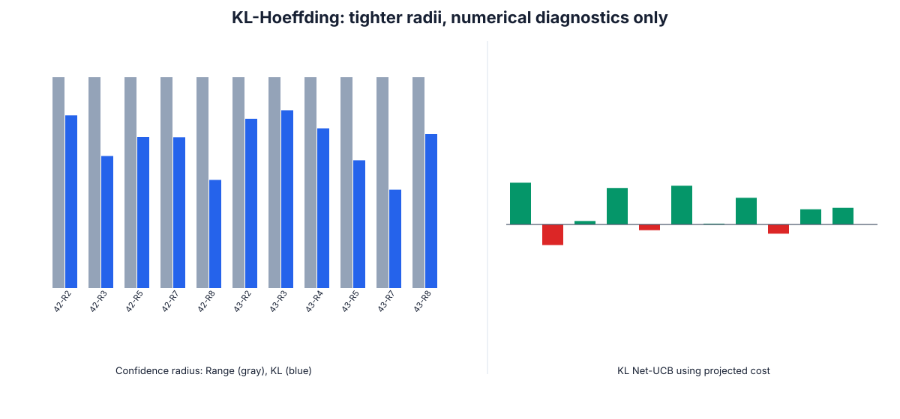

# Experimental Results Audit: Verified-Failure-Driven Active Learning (V7)

> **Artifact-only paper audit.** Generated from completed repository artifacts on the current `feat/v7-minimal-cost-aware` branch. No GPU, model inference, Teacher API, training, or sealed-test retuning was performed. Percentages are accuracy ×100; differences are percentage points (pp). `±` is the sample standard deviation across seeds; single-seed rows are explicitly marked rather than assigned a zero standard deviation.

## Executive evidence ledger

This audit found **30 unique completed result artifacts spanning 23 method/protocol labels**: 15 core budget-128 comparison rows, six controlled Verification ON/OFF runs, three target-only verified runs, four additional V2/V3/V5 objective/evolution runs, and two completed 256-example extended trajectories. It distinguishes 15,000-example sealed HANS evaluation from the older 30,000-example baseline benchmark. Raw `result.json` takes precedence over stale prose: notably, all eight implemented Margin/Core-set/BADGE/CAL MNLI/synthetic runs are now complete.

The strongest single-seed budget-128 result in the common table is **Uncertainty MNLI (66.99% HANS)**, whereas the strongest synthetic row is **Failure-driven, no verification (65.47%)**. The newer three-seed early-stopping V7 reaches `71.68 ± 2.90` with verification ON and `72.12 ± 1.45` with verification OFF under the current three-way evaluator. The two extended 256-example runs reach `75.91 ± 1.17` but terminate at maximum budget, not a certified Cost-Aware STOP.

## A. Experimental setup

**Research question.** Can confidence-screened, failure-directed synthetic acquisition improve HANS robustness while retaining MNLI performance under a strict evaluation firewall?

The student is Qwen3-1.7B with LoRA (`r=8`, `alpha=16`) and AdamW; the Teacher is Qwen3-14B. The canonical fixed-budget protocol uses four rounds ×32 examples (128 total), while the extended Cost-Aware trajectories allow eight rounds (256 total). Training uses three-way NLI labels; HANS is binary, mapping neutral and contradiction to non-entailment. The current evaluator predicts the three-way argmax then maps to binary; Direct Binary instead compares `P(E)` with `P(N)+P(C)` and is reported as a diagnostic.

The frozen 30,000 HANS corpus is partitioned into discovery (3,750), verification (3,750), intervention pool (3,750), gain evaluation (3,750), and sealed final test (15,000). Gain evaluation is further split into a 900-example `stopping_eval` subset and a 2,850-example held-out report subset. `stopping_eval` supports epoch-level early stopping; `gain_eval`/held-out reporting and sealed HANS are not used for training selection or Cost-Aware tuning. MNLI matched/mismatched are retention views. The separate historical HANS baseline benchmark evaluated all 30,000 records and is therefore not numerically interchangeable with sealed-HANS results.

| Component | Frozen protocol |
|---|---|
| Student / Teacher | Qwen3-1.7B LoRA / Qwen3-14B |
| Standard / extended budget | 128 (4×32) / 256 (8×32) examples |
| Primary robustness metric | sealed HANS 15k overall and non-entailment accuracy |
| Retention | MNLI matched / mismatched |
| Online model-selection view | HANS `stopping_eval`, 900 examples |
| Held-out views | 2,850 gain report; sealed HANS 15k; MNLI |
| Main seeds | historical comparisons: 42; ON/OFF: 42/43/44; extended: 42/43 |
| Firewall | no verification probe, stopping row, gain-report row, or sealed-test row enters the training loss |

Provenance: `flow_v7.md`, `README.md`, frozen manifests under `outputs/stage2_shared/`, and resolved run configs.

## B. Main results: comparison with existing methods

**Research question.** How does V7 compare with reproduced active-learning selectors under budget 128?

The published selectors below are **implemented/reproduced acquisition baselines in this codebase**, not numbers copied from the original papers. Human-MNLI rows have different data access from HANS-guided synthetic rows; they are diagnostic cross-source comparisons rather than equal-access controls.

| Method | Acquisition source | Objective | Budget | Seed(s) | HANS | HANS non-ent. | MNLI-m | MNLI-mm | Status |
|---|---|---|---|---|---|---|---|---|---|
| Zero-shot Qwen | reference | none | 0 | 42 | 63.85 | 33.75 | 57.66 | 57.94 | complete |
| Random synthetic | synthetic | CE | 128 | 42 | 64.46 | 35.17 | 58.39 | 58.51 | complete |
| Random MNLI | human MNLI | CE | 128 | 42 | 65.26 | 37.65 | 59.49 | 59.77 | complete |
| Uncertainty MNLI | human MNLI | CE | 128 | 42 | 66.99 | 42.30 | 61.04 | 61.54 | complete |
| Failure-driven, no verification | synthetic | CE | 128 | 42 | 65.47 | 38.37 | 59.34 | 59.63 | complete |
| Margin (MNLI) | human MNLI | CE | 128 | 42 | 66.13 | 39.88 | 60.13 | 60.68 | complete |
| Core-set (MNLI) | human MNLI | CE | 128 | 42 | 65.13 | 37.29 | 59.40 | 59.64 | complete |
| BADGE (MNLI) | human MNLI | CE | 128 | 42 | 65.70 | 38.79 | 59.68 | 60.21 | complete |
| CAL (MNLI) | human MNLI | CE | 128 | 42 | 64.75 | 36.28 | 59.05 | 59.37 | complete |
| Margin (synthetic) | static verified synthetic | CE | 128 | 42 | 64.71 | 35.74 | 58.56 | 58.72 | complete |
| Core-set (synthetic) | static verified synthetic | CE | 128 | 42 | 65.05 | 36.92 | 59.01 | 59.26 | complete |
| BADGE (synthetic) | static verified synthetic | CE | 128 | 42 | 64.70 | 35.80 | 58.61 | 58.77 | complete |
| CAL (synthetic) | static verified synthetic | CE | 128 | 42 | 65.03 | 36.86 | 59.10 | 59.30 | complete |
| Verified V7 continuation | closed-loop synthetic | CE | 128 | 42 | 65.00 | 36.33 | 58.63 | 58.96 | complete |
| Verified V7 consolidation | closed-loop synthetic | CE | 128 | 42 | 64.72 | 35.58 | 58.44 | 58.66 | complete |
| V7 early-stop Verification ON | closed-loop synthetic | CE + epoch early stopping | 128 | 42/43/44 | 71.68 ± 2.90 | 56.68 ± 8.03 | 59.92 ± 2.33 | 60.01 ± 2.89 | complete |
| V7 early-stop Verification OFF | closed-loop synthetic | CE + epoch early stopping | 128 | 42/43/44 | 72.12 ± 1.45 | 59.02 ± 9.18 | 62.32 ± 0.93 | 62.72 ± 0.62 | complete |

*Figure 1: Sealed-HANS 15k accuracy for historical/reproduced budget-128 baselines, each Verification ON/OFF seed at budget 128, and each extended R8 seed at budget 256. Section boundaries and `[B128]/[B256]` labels prevent the extended results from being read as an equal-budget ranking.*

At seed 42, uncertainty sampling from MNLI exceeds historical V7 continuation by `1.9933` pp overall and `5.9703` pp on non-entailment. Core-set and CAL on the static verified synthetic pool are within 0.06 pp of historical V7 continuation, which is not evidence of a meaningful ordering from one seed. Failure-driven acquisition without verification is 0.4667 pp above historical V7 continuation; verification is therefore not uniformly beneficial in the old protocol.

*Figure 2: HANS non-entailment versus MNLI matched accuracy. Circles denote historical seed-42 budget-128 runs, squares denote individual ON/OFF budget-128 runs, and diamonds denote R8 budget-256 runs. Human-MNLI access and unequal budgets remain explicit confounders.*

### Extended 256-example trajectories (separate budget)

| Run | Source | Budget | Seed | HANS three-way | HANS direct | HANS non-ent. | MNLI-m | Terminal reason |
|---|---|---|---|---|---|---|---|---|
| V7 extended seed 42 | closed-loop synthetic + pilots | 256 | 42 | 75.08 | 75.83 | 69.05 | 59.75 | maximum_budget_reached_with_remaining_hypotheses |
| V7 extended seed 43 | closed-loop synthetic + pilots | 256 | 43 | 76.74 | 76.46 | 75.12 | 61.21 | maximum_budget_reached_with_remaining_hypotheses |

The two extended runs average `75.91 ± 1.17` three-way HANS and `76.15 ± 0.44` Direct Binary. This is a strong completed result but not directly rankable against budget-128 methods. Both used all 256 examples and ended with `maximum_budget_reached_with_remaining_hypotheses`; they did not demonstrate Cost-Aware early stopping.

### Historical HANS-30k benchmark (not the sealed 15k protocol)

| Method | Budget | HANS-30k overall | Non-entailment | Lexical | Subsequence | Constituent |
|---|---:|---:|---:|---:|---:|---:|
| Base | 0 | 63.6367 | 33.5067 | 82.9900 | 57.3200 | 50.6000 |
| Random | 32 | 63.7967 | 33.9200 | 83.3300 | 57.4200 | 50.6400 |
| Uncertainty | 32 | 64.4833 | 35.8067 | 84.3000 | 58.2200 | 50.9300 |

These early 30k results establish a baseline trend but cannot be merged with the sealed-15k tables because both evaluation membership and acquisition budget differ. Source: `reports/hans_baselines_seed42/data/run_summary.csv`.

## C. Ablation studies

### C.1 Verification ON versus OFF (controlled)

**Research question.** Does hypothesis verification improve V7 when training policy, seeds, selector, and budget are fixed?

| Mode | Seed | HANS 3-way | HANS direct | Non-ent. 3-way | MNLI-m | Teacher tokens | Calls |
|---|---|---|---|---|---|---|---|
| ON | 42 | 68.63 | 71.85 | 48.67 | 57.81 | 1004840 | 482 |
| ON | 43 | 74.41 | 74.86 | 64.73 | 62.42 | 1037905 | 493 |
| ON | 44 | 71.99 | 73.69 | 56.64 | 59.51 | 1007824 | 478 |
| OFF | 42 | 70.51 | 71.15 | 50.65 | 61.58 | 214559 | 69 |
| OFF | 43 | 73.31 | 74.06 | 68.84 | 63.36 | 213222 | 69 |
| OFF | 44 | 72.53 | 73.20 | 57.58 | 62.01 | 214948 | 69 |

*Figure 3: Mean ± sample standard deviation over seeds 42–44 on sealed HANS. The conclusion changes with the prediction rule.*

Under the current three-way-to-binary evaluator, ON averages `71.6756%` and OFF `72.1178%`, so ON is `-0.4422` pp lower. Under Direct Binary, ON averages `73.4667%` and OFF `72.8044%`, making ON `+0.6622` pp higher. The controlled ablation therefore does not support a rule-independent claim that verification improves accuracy. OFF also retains MNLI better on average (`62.32 ± 0.93` versus `59.92 ± 2.33`).

### C.2 Verified versus unverified and V2–V7 evolution

**Research question.** Which improvements survive historical protocol changes?

| Version | HANS | Non-ent. | MNLI-m | MNLI-mm | Raw source |
|---|---|---|---|---|---|
| V2 CE | 64.38 | 34.82 | 58.26 | 58.43 | outputs/stage2_runs_ours_verified_v2_ce/experiment_a/ours_verified/budget_128/seed_42/result.json |
| V2 pairwise | 64.34 | 34.77 | 58.25 | 58.44 | outputs/stage2_runs_ours_verified_v2_pairwise/experiment_a/ours_verified/budget_128/seed_42/result.json |
| V3 CE | 64.75 | 36.10 | 58.77 | 58.94 | outputs/stage2_runs_ours_verified_v3_ce/experiment_b/ours_verified/budget_128/seed_42/result.json |
| V5 CE | 64.82 | 36.48 | 58.81 | 58.94 | outputs/stage2_runs_ours_verified_v5_ce/experiment_b/ours_verified/budget_128/seed_42/result.json |
| V7 consolidation | 64.72 | 35.58 | 58.44 | 58.66 | outputs/stage2_runs_ours_verified_v7_dual/experiment_b/ours_verified/budget_128/seed_42/branches/consolidation/result.json |
| V7 continuation | 65.00 | 36.33 | 58.63 | 58.96 | outputs/stage2_runs_ours_verified_v7_dual/experiment_b/ours_verified/budget_128/seed_42/branches/continuation/result.json |

*Figure 4: Historical seed-42 evolution. This is a cross-protocol comparison, not a controlled component ablation.*

V2 CE to V7 continuation improves HANS by `0.6200` pp and non-entailment by `1.5093` pp. Continuation exceeds consolidation by `0.2800` pp using the same selected 128 examples, but only seed 42 is available. V4 has no distinct completed result; V6 is a preserved checkpoint-continuity failure and is excluded from performance claims.

### C.3 CE versus pairwise objective (controlled V2)

**Research question.** Does the implemented pairwise objective help when selected IDs are identical?

| Metric | CE | Pairwise | Pairwise − CE |
|---|---|---|---|
| HANS overall | 64.38 | 64.34 | -0.0400 pp |
| HANS entailment | 93.84 | 93.81 | -0.0266 pp |
| HANS non-entailment | 34.82 | 34.77 | -0.0534 pp |
| MNLI matched | 58.26 | 58.25 | -0.0102 pp |
| MNLI mismatched | 58.43 | 58.44 | +0.0102 pp |

The 128 selected IDs are identical and in the same order. Pairwise is 0.0400 pp lower on HANS overall and 0.0534 pp lower on non-entailment; the differences are tiny and single-seed. The report does not relabel CE runs as pairwise merely because pair structure was used during selection.

### C.4 Target-only verification and lifecycle

The early target-only protocol over seeds 42–44 yields `65.25 ± 1.02` HANS. In the newer Verification-ON final audits, hypothesis-state counts are:

| Seed | Certified | Unresolved | Refuted |
|---|---|---|---|
| 42 | 2 | 3 | 0 |
| 43 | 1 | 4 | 0 |
| 44 | 1 | 3 | 1 |

Unresolved hypotheses remain distinct from refuted hypotheses and can be retained for additional evidence. This is a protocol property, not evidence that every retained hypothesis is useful.

## D. Data efficiency and learning curves

**Research question.** How does performance evolve with cumulative acquisition, and is improvement monotonic?

*Figure 5: Accuracy on the fixed 900-example stopping subset. Solid lines are means across seeds 42–44; dashed extended trajectories are individual seeds. These are not sealed-test curves.*

Both ON and OFF share their initial 32-example state within each seed, then diverge. The trajectories are non-monotonic: ON seed 42 peaks at 71.0% at 96 examples and falls to 66.67% at 128, while extended seed 42 falls at 160 before recovering at 224. This supports reporting every round rather than only the best retrospective checkpoint. It does not authorize selecting a checkpoint on sealed HANS. MNLI retention and final HANS are only available at finalized checkpoints, so they are not interpolated into this curve.

## E. HANS heuristic and failure-type analysis

**Research question.** Are gains distributed across HANS heuristics and labels?

| Heuristic | Zero-shot seed 42 | Verification ON (3 seeds) | Verification OFF (3 seeds) |
|---|---|---|---|
| lexical overlap | 83.17 | 74.26 ± 6.64 | 81.23 ± 4.91 |
| subsequence | 57.64 | 65.85 ± 3.06 | 65.85 ± 0.97 |
| constituent | 51.01 | 74.90 ± 1.56 | 69.36 ± 9.28 |

The label breakdown reveals the central trade-off: zero-shot is entailment-heavy (93.85% entailment, 33.75% non-entailment), whereas later V7 checkpoints substantially improve non-entailment. The three-way ON mean non-entailment is `56.68 ± 8.03` and OFF is `59.02 ± 9.18`. Per-subcase artifacts exist for all sealed evaluations, but a 30-subcase ranking is placed in the appendix recommendation because multiple comparisons and seed variance make compact main-text claims fragile.

## F. Cost, resource efficiency, and stopping diagnostics

**Research question.** What resource overhead is measured, and does any confidence method establish an online STOP?

Verification ON uses `1016856 ± 18290` total recorded teacher tokens versus `214243 ± 905` for OFF. Those final totals include the run's post-training audit, whereas the checkpoint-efficiency analysis below uses cumulative acquisition teacher tokens through each round. Shared initial-pool costs are excluded in both views.

| Mode | Seed | R3 HANS | R4 HANS | R4−R3 (pp) | R3 tokens | R4 tokens | Extra R4 tokens | Direct Δ (pp) | Pareto reading |
|---|---|---|---|---|---|---|---|---|---|
| ON | 42 | 71.25 | 68.63 | -2.62 | 544.9k | 828.4k | +283.5k | +0.60 | R3 dominates under current rule |
| ON | 43 | 69.27 | 74.41 | +5.13 | 547.8k | 822.3k | +274.5k | +5.59 | R4 improves |
| ON | 44 | 68.53 | 71.99 | +3.45 | 541.0k | 808.1k | +267.2k | +5.13 | R4 improves |
| OFF | 42 | 64.69 | 70.51 | +5.82 | 144.2k | 214.6k | +70.4k | +6.47 | R4 improves |
| OFF | 43 | 69.50 | 73.31 | +3.81 | 141.2k | 213.2k | +72.1k | +4.51 | R4 improves |
| OFF | 44 | 69.13 | 72.53 | +3.41 | 142.5k | 214.9k | +72.5k | +4.07 | R4 improves |

The most favorable verified efficiency case is ON seed 42: R3 reaches `71.2533%` full-HANS Three-way with `544,918` cumulative acquisition tokens; R4 consumes another `283,452` tokens yet falls to `68.6333%`. Thus R3 Pareto-dominates R4 for this seed under the current evaluator and also avoids one 32-example update. This is the clearest empirical motivation for the paper's stopping component: additional verified acquisition is not guaranteed to improve robustness and can move the model to a worse performance–cost point. The result is not universal: R4 improves Three-way accuracy for the other five seed/mode pairs, and under Direct Binary the same ON seed-42 R4 improves by `+0.60 pp`. Because full-HANS is sealed reporting data, this Pareto finding is retrospective evidence for designing a future validation-based stop rule—not authorization to select R3 post hoc.

GPU wall-clock fields are proxies, not hardware-utilization integrals, and the seed-42 OFF run was affected by contention, so timing comparisons are descriptive rather than controlled cost measurements. The `+283,452` figure is the observed round-4 acquisition-token increment; it is not a full counterfactual pipeline saving because a run stopped at R3 could still require a final audit/evaluation.

*Figure 6: Left, retrospective full-HANS Three-way performance versus cumulative acquisition teacher tokens for R3 (open) and R4 (filled); ON seed 42 moves down and right. Right, measured cached-pilot wall-hours consumed by Fixed-32 versus adaptive simulation. Neither panel supplies an online stopping certificate.*

Adaptive allocation uses 20 versus 160 pilots for seed 42 and 24 versus 192 for seed 43, saving 7.40 and 11.19 measured GPU wall-hours relative to Fixed-32. Every adaptive outcome is `uncertified_continue`; these are retrospective compute savings, not evidence of safe stopping.

### F.1 Legacy, Range-Aware, and KL-Hoeffding

Legacy symmetric Hoeffding has radius 0.593443; Range-Aware Hoeffding reduces it to 0.296721. Across 11 complete 32-pilot decisions, KL-Hoeffding ranges from 0.138361 to 0.250092, reducing radius by `15.71%–53.37%` (mean `30.96%`).

| Seed | Round | Mean gain | Range radius | KL radius | Reduction | KL Net-UCB* | Numerical STOP* | Certified STOP |
|---|---|---|---|---|---|---|---|---|
| 42 | 2 | 0.016602 | 0.296721 | 0.242934 | 18.13% | 0.079857 | no | no |
| 42 | 3 | -0.045410 | 0.296721 | 0.185790 | 37.39% | -0.039298 | yes | no |
| 42 | 5 | -0.026367 | 0.296721 | 0.212642 | 28.34% | 0.006597 | no | no |
| 42 | 7 | 0.037109 | 0.296721 | 0.212234 | 28.47% | 0.069666 | no | no |
| 42 | 8 | 0.016602 | 0.296721 | 0.152173 | 48.72% | -0.010904 | yes | no |
| 43 | 2 | 0.015625 | 0.296721 | 0.238073 | 19.77% | 0.074020 | no | no |
| 43 | 3 | -0.068848 | 0.296721 | 0.250092 | 15.71% | 0.001566 | no | no |
| 43 | 4 | 0.005859 | 0.296721 | 0.224710 | 24.27% | 0.050891 | no | no |
| 43 | 5 | -0.017578 | 0.296721 | 0.179647 | 39.46% | -0.017609 | yes | no |
| 43 | 7 | 0.070312 | 0.296721 | 0.138361 | 53.37% | 0.028996 | no | no |
| 43 | 8 | -0.005371 | 0.296721 | 0.216851 | 26.92% | 0.031802 | no | no |

`*` uses the frozen **projected marginal decision cost** `0.8983888889` and `lambda=0.2`. It is an optimistic hypothetical diagnostic, not a proved Cost-LCB. It yields `3` numerical candidates: seed 42 R3, seed 42 R8, seed 43 R5. The first is R3 for seed 42 and R5 for seed 43, corresponding counterfactually to 64 and 128 already-trained examples before the next main update. These are not realized budget/cost savings.

*Figure 7: Same-round conditional bounds. Red bars are numerical candidates only; no bar is a statistically certified pre-round STOP.*

Using the protocol-based conditional executable-round Cost-LCB `$0.2264` instead gives zero KL numerical STOPs. More fundamentally, current-round pilots are observed only after Teacher/generation/selection, conditional independence of deterministic pilot seeds is unproved, and no cross-round policy/drift theorem transfers them to a valid pre-round decision. Thus **certified STOP count is zero** and both extended runs end at budget 256.

## G. Key findings and limitations

| Claim | Classification | Evidence | Scope |
|---|---|---|---|
| Uncertainty MNLI is the strongest seed-42 budget-128 row (66.9933%). | Direct completed result | raw Stage-2 result | cross-source, n=1 |
| Verification ON is 0.4422 pp below OFF under three-way, but 0.6622 pp above under Direct Binary. | Controlled ablation | six ON/OFF runs + diagnostics | 3 seeds; rule-dependent |
| V7 extended reaches 75.91% ± 1.17% three-way at budget 256. | Direct completed result | two extended results | 2 seeds, unequal budget |
| V7 learning is non-monotonic across rounds. | Direct completed result | stopping-eval curves | validation subset, not sealed test |
| Pairwise does not improve V2 over CE in seed 42. | Controlled ablation | identical selected IDs | n=1 |
| Adaptive pilots greatly reduce retrospective pilot compute. | Retrospective diagnostic | cached pilot timing simulation | no certified decision |
| KL is tighter than Range-Aware Hoeffding. | Assumption-conditional result | 11 complete pilot sets | fixed shard; independence unproved |
| Cost-Aware stopping safely saves training budget. | Unsupported claim | no certified STOP | must not be claimed |

The principal limitations are unequal data access (human MNLI versus synthetic), unequal budgets (128 versus 256), only one seed for most historical methods, two seeds for extended runs, prediction-rule sensitivity, protocol changes across V2–V7, incomplete pilot evidence in three rounds, shared fixed evaluation shards, and a projected cost that is not a proven lower bound. Seed 42 was repeatedly used during development; it should not be described as untouched confirmatory evidence.

## Recommended main-paper tables and figures

1. Main budget-128 table, separated into human-MNLI and synthetic acquisition blocks.
2. Three-seed Verification ON/OFF table with both HANS rules.
3. Figure 2 (HANS non-entailment versus MNLI retention).
4. Figure 5 (validation learning curves), explicitly labeled `stopping_eval`.
5. A small separate table for the two budget-256 extended runs.

## Recommended appendix tables and figures

1. Full V2–V7 historical ledger and CE/pairwise controlled ablation.
2. HANS heuristic/state tables and full 30-subcase CSV artifacts.
3. Resource accounting and adaptive-pilot diagnostics.
4. KL/Range/legacy confidence-bound table and assumption audit.
5. HANS-30k baseline benchmark, clearly separated from sealed HANS-15k.

## Claim–evidence matrix

| Claim family | Primary artifact | Evaluation role | Admissible wording |
|---|---|---|---|
| Seed-42 baseline ranking | `outputs/stage2_runs*/.../result.json` | sealed HANS 15k / MNLI | completed single-seed comparison |
| ON/OFF effect | `outputs/stage2_runs_v7_training_verification_ablation/` | sealed HANS 15k | controlled three-seed ablation |
| Prediction-rule sensitivity | `outputs/stage2_diagnostics/v7_hans_prediction_rules/` | post-hoc frozen inference | diagnostic; do not select rule on final test |
| Extended performance | `outputs/stage2_runs_v7_minimal_cost_aware_m32_decision_cost_v2/` | final HANS/MNLI | completed two-seed budget-256 result |
| Cost-Aware decisions | `outputs/stage2_diagnostics/v7_*` | offline replay | retrospective/assumption-conditional only |
| HANS-30k baseline | `reports/hans_baselines_seed42/data/` | old full benchmark | separate protocol only |

## Missing or unverifiable results

- No distinct completed V4 result exists.
- V6 checkpoint continuity failed; its zero-shot-equivalent output is a preserved diagnostic, not a rankable run.
- Historical V2/V3/V5/V7 comparison lacks seeds 43/44.
- Extended seed 44 is absent.
- No statistically valid pre-round gain transfer or certified Cost-Aware STOP exists.
- Shared initial-pool and round-1 costs are incomplete in incremental cost accounting; total pipeline cost is partial.
- Fixed-shard pilot independence/unbiasedness is not established.
- Teacher generation and reviewer calls use the same teacher checkpoint in separate roles, not independent models.

## Draft: Experiments and Results

We evaluate a Qwen3-1.7B NLI student adapted with LoRA under a verified-failure-driven active-learning protocol. A Qwen3-14B teacher proposes failure hypotheses, generates target probes, and produces QC-filtered synthetic intervention pairs. The standard acquisition budget is 128 examples in four batches of 32; an extended protocol permits 256 examples. We partition HANS into disjoint discovery, verification, intervention, gain-evaluation, and sealed-test roles. Epoch-level early stopping observes only a fixed 900-example subset, while the 15,000-example sealed HANS test and MNLI matched/mismatched sets remain reporting-only. We report HANS overall and non-entailment accuracy, together with MNLI retention. Published active-learning methods are reproduced within our implementation and are not quoted results from their original papers.

At budget 128 and seed 42, uncertainty sampling from the human-labelled MNLI pool obtains the strongest sealed-HANS result (66.99%), followed by Margin-MNLI (66.13%) and BADGE-MNLI (65.70%). Historical V7 continuation reaches 65.00%, while Core-set and CAL on a static verified synthetic pool reach 65.05% and 65.03%, respectively. These small differences are not statistically meaningful at one seed, and comparisons with MNLI acquisition are cross-source because the methods have different data access. The main gap is concentrated in non-entailment: uncertainty-MNLI exceeds historical V7 continuation by 5.97 pp.

The controlled three-seed verification ablation is prediction-rule dependent. With the current three-way-to-binary rule, Verification ON averages 71.68% and OFF 72.12%; with Direct Binary aggregation, ON averages 73.47% and OFF 72.80%. Consequently, verification is not uniformly superior under every evaluation mapping. Learning curves are also non-monotonic: for example, seed 42 ON reaches 71.0% on the stopping subset after 96 examples and declines after the fourth batch. This motivates reporting full trajectories and predeclared checkpoint rules rather than retrospectively choosing the best sealed-test checkpoint.

With a maximum budget of 256, the two completed extended V7 runs obtain 75.91 ± 1.17 three-way HANS and 76.15 ± 0.44 Direct Binary. Both terminate by budget exhaustion, not by a statistically certified gain–cost decision. Offline KL-Hoeffding replay tightens the Range-Aware radius by 30.96% on average across 11 complete pilot sets. A projected-cost diagnostic produces numerical stopping candidates, but the projected marginal cost is not a proved lower confidence bound and same-round pilots are unavailable before Teacher acquisition. We therefore report zero certified STOPs and treat all apparent savings as counterfactual diagnostics.

Overall, the experiments demonstrate substantial HANS gains from the strengthened V7 training protocol and show that verified synthetic acquisition can approach reproduced synthetic active-learning baselines. They do not establish state of the art: most historical comparisons use one development seed, human-MNLI methods have stronger data access, and Cost-Aware stopping lacks the assumptions required for a valid pre-round certificate.

## Reproducibility and provenance

Generated by `scripts/build_experimental_result.py`. Supporting audit tables are stored in `reports/experimental_result_figures/`; raw outputs remain read-only. Figure SVGs are paper-editable and PNGs are rendered at 300 DPI.
