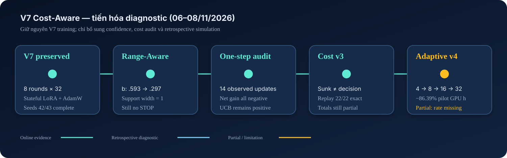
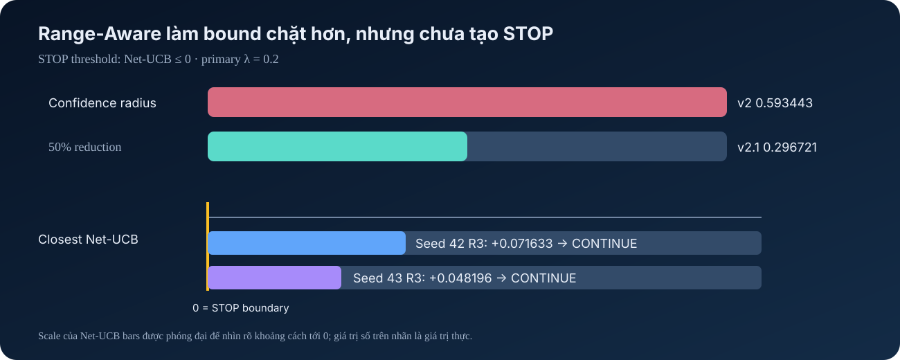
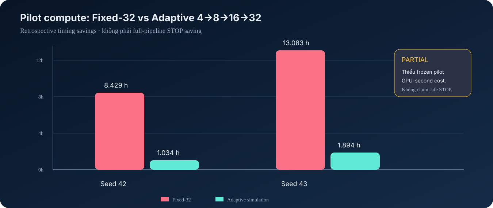
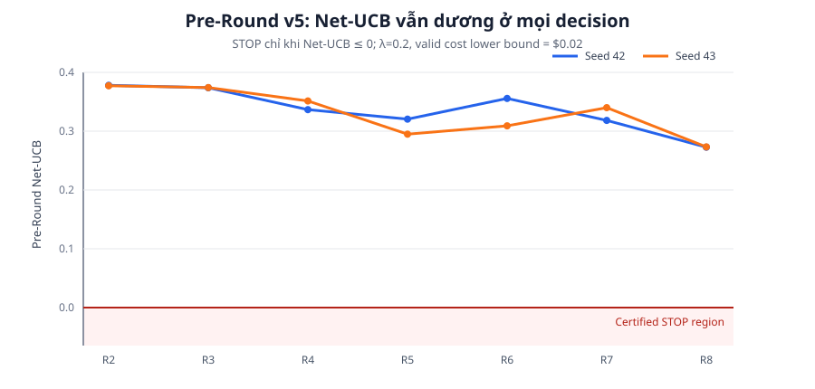
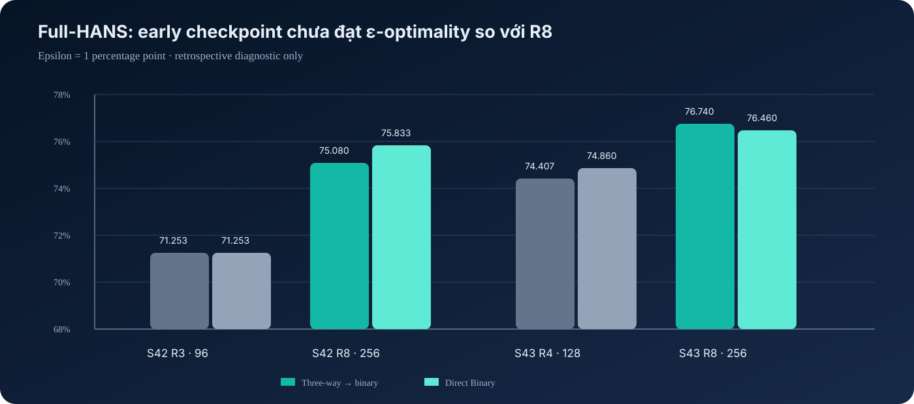

# Báo cáo tiến độ V7 Cost-Aware

**Khoảng thời gian cập nhật:** 06/11/2026–08/11/2026  
**Branch:** `feat/v7-minimal-cost-aware`  
**Phạm vi:** V7 Minimal Cost-Aware, retrospective diagnostics, adaptive pilot allocation và Pre-Round Stopping v5  
**Nguyên tắc:** không dùng HANS/MNLI sealed test hoặc future-round metrics để đưa ra quyết định online.

> Báo cáo này phân biệt ba mức bằng chứng: **kết quả thực nghiệm hoàn chỉnh**, **CPU replay/diagnostic**, và **kết quả partial** do còn thiếu cost metadata. Các kết quả diagnostic không thay đổi checkpoint hay historical artifacts.



## 1. Tóm tắt điều hành

Trong giai đoạn này, phần training V7 không bị thay đổi. Công việc tập trung vào việc kiểm tra controller Cost-Aware sau khi trajectories seeds 42/43 đã hoàn tất, chuẩn hóa cost accounting và giảm overhead của 32 pilot observations.

Các kết quả quan trọng nhất:

1. **V7 Cost-Aware seeds 42/43 đều chạy đủ 8 rounds, 256 examples và kết thúc vì maximum budget**, không phải do đạt Gain-Cost STOP.
2. **Range-Aware Hoeffding giảm confidence radius một nửa**, từ `0.593443` xuống `0.296721`, nhưng Net-UCB vẫn dương ở mọi round có đủ evidence; vì vậy quyết định vẫn là CONTINUE.
3. **Early stopping tại các checkpoint được kiểm tra không đạt epsilon-optimality** với `epsilon=0.01`: seed 42 R3 mất 3.83–4.58 pp so với R8; seed 43 R4 mất 1.60–2.33 pp.
4. One-step benchmark cho thấy **observed one-step net gain âm ở toàn bộ 14 updates**, trong khi controller vẫn CONTINUE do upper confidence bound còn rộng. Đây là dấu hiệu controller bảo thủ, không phải bằng chứng confidence theorem sai.
5. Cost audit xác nhận phải dùng **avoidable decision cost** trong STOP/CONTINUE và loại sunk exploration cost khỏi phương trình quyết định. Tổng pilot GPU time quan sát được là `77,443.81 s = 21.51 GPU-hours`, lớn hơn đáng kể main intervention cost.
6. Adaptive pilot v4 đã có `frozen_pilot_gpu_second_cost` hợp lệ: giảm số pilots từ `352` xuống `44`, tiết kiệm `18.58 GPU-hours` (86.39%) và `$253.81` projected pilot cost. VOI thật sự được tính, nhưng không tạo STOP; mọi quyết định vẫn là `uncertified_continue`.
7. Pre-Round Stopping v5 replay `14/14` quyết định trên seeds 42/43 với independent held-out risk set và conservative full-round cost lower bound. Không round nào đạt STOP: Net-UCB nhỏ nhất vẫn là `0.272785` (seed 42) và `0.273213` (seed 43).

## 2. Những thay đổi chính

### 2.1. Protocol v2.1: Range-Aware Hoeffding

Pilot gain được định nghĩa:

`X_j = accuracy_after_j - A_0`

Do 32 pilots trong một round dùng cùng fixed evaluation shard và baseline `A_0`, support có điều kiện là:

`X_j ∈ [-A_0, 1-A_0]`, với width bằng `1`.

Confidence radius được sửa thành:

`b = sqrt(log(2KT/δ) / (2m))`

với cấu hình giữ nguyên `m=32`, `K=1`, `T=7`, `δ=0.05`, `λ=0.2`. Kết quả:

| Phiên bản | Support width | Radius | Thay đổi |
|---|---:|---:|---:|
| v2 Hoeffding cũ | 2 | 0.593443 | — |
| v2.1 Range-Aware | 1 | 0.296721 | giảm 50.0% |



Decision rule không đổi:

`U = Gain_UCB − λ × decision_cost`

`STOP` chỉ khi `U ≤ 0` và evidence gate hợp lệ. Với `decision_cost=0.898389`, ta có `λC=0.179678`. Tại `λ=0.2`, không seed nào đạt STOP:

| Seed | Round gần STOP nhất | Delta-hat | Net-UCB v2 | Net-UCB v2.1 | Decision |
|---:|---:|---:|---:|---:|---|
| 42 | 3 | -0.045410 | 0.368355 | 0.071633 | CONTINUE |
| 43 | 3 | -0.068848 | 0.344917 | 0.048196 | CONTINUE |

Ngưỡng cần thiết là `Delta-hat ≤ -0.117044`; các estimated gains quan sát được chưa đủ âm để tạo STOP certificate.

### 2.2. Evidence gates và unresolved hypotheses

Ba trạng thái V7 `certified / unresolved / refuted` được giữ nguyên. `Unresolved` không bị biến thành `refuted` và cũng không tự tạo STOP.

- Seed 42: rounds 4 và 6 không có certified hypothesis nhưng evidence chưa exhausted.
- Seed 43: round 6 có cùng tình trạng.
- Các round này CONTINUE theo evidence gate, không được tính là Gain-Cost STOP.

### 2.3. Chuẩn hóa cost accounting

Cost model được tách thành ba lớp:

```text
Exploration đã phát sinh                 Intervention nếu CONTINUE
teacher / verification / generation     main LoRA training
pilots / pilot evaluation               epoch validation
              │                                  │
              └──── total_pipeline_cost ─────────┘
                         (reporting)

Online STOP/CONTINUE chỉ dùng decision_cost ở nhánh bên phải.
Exploration cost là sunk cost và không được trừ lần nữa trong Net-UCB.
```

| Loại cost | Ý nghĩa | Dùng trong online decision? |
|---|---|---|
| `exploration_cost` | Teacher, verification, generation/QC, pilots đã phát sinh | Không |
| `decision_cost` | Chi phí tăng thêm có thể tránh nếu STOP ngay | Có |
| `total_pipeline_cost` | Tổng retrospective reporting | Không |

Audit xác nhận numerical replay khớp `22/22` hàng có thể đối chiếu với v2/v2.1. Không có thay đổi giả về quyết định sau khi chỉ tái cấu trúc cost accounting.

### 2.4. One-Step Cost-Aware Benchmark

Benchmark so sánh expected gain từ pilots với observed gain của đúng một main update trên held-out evaluation set riêng. Hai seeds đều có manifest hợp lệ với `2,402` evaluation examples.

Kết quả tổng hợp:

- 14/14 observed one-step net gains âm sau khi trừ actual intervention cost.
- 11/11 rounds có pilot estimate đều nằm dưới confidence upper bound của cả v2 và v2.1.
- 3 rounds còn lại đi qua evidence gate và không có Gain-UCB để kiểm tra.
- Quyết định CONTINUE vì Net-UCB vẫn dương, do đó one-step alignment được đánh dấu `misaligned`; đây là retrospective diagnostic, không phải tuning signal.

Điểm quan trọng: một realized main update không phải expected population gain và không đủ để xác nhận hoặc bác bỏ định lý thống kê.

### 2.5. Decision-Aware Adaptive Pilot Allocation v4

Lịch pilot mới được mô phỏng tuần tự:

`4 → 8 → 16 → 32`

Multiple looks dùng Bonferroni alpha spending. Heuristic chỉ được quyết định chạy thêm pilots hoặc trả về `uncertified_continue`; nó không được tự tạo STOP. STOP vẫn yêu cầu valid Net-UCB không dương.



| Seed | Fixed-32 pilots | Adaptive pilots | Giảm pilots | Fixed GPU h | Adaptive GPU h | GPU h tiết kiệm |
|---:|---:|---:|---:|---:|---:|---:|
| 42 | 160 | 20 | 87.5% | 8.429 | 1.034 | 7.396 (87.74%) |
| 43 | 192 | 24 | 87.5% | 13.083 | 1.894 | 11.188 (85.52%) |
| **Tổng** | **352** | **44** | **87.5%** | **21.512** | **2.928** | **18.584 (86.39%)** |

Kết quả quyết định:

- Certified STOP: `0`.
- Certified CONTINUE: `0`.
- Tất cả trajectory decisions vẫn là `uncertified_continue`.
- Không có main-training budget saving vì pipeline không STOP.

`frozen_pilot_gpu_second_cost` hiện đã được lấy từ cost config trước khi quan sát pilot outcomes:

- Projected cost mỗi pilot: `$0.824044`, trong đó evaluation/validation chiếm khoảng 97.5%.
- Chi phí block tiếp theo 4 pilots: `$3.296178`, tương ứng utility penalty `0.659236` tại `λ=0.2`.
- Expected information benefit quan sát được bằng 0 và VOI bằng `-0.659236`, nên allocator dừng sampling tại `m=4` với reason `expected_information_benefit_not_above_projected_pilot_cost`.

Kết quả không còn là fallback do thiếu projection. Tuy nhiên nó cũng cho thấy cost model hiện tại khiến lịch `4→8→16→32` thực tế co lại thành fixed-4: ngay cả khi xác suất tạo STOP bằng 1, maximum avoidable decision utility `λ×0.898389=0.179678` vẫn thấp hơn penalty của 4 pilots tiếp theo. Đây là pilot-cost saving, không phải main-training STOP.

### 2.6. Pre-Round Cost-Aware Stopping v5

V5 kiểm tra khả năng STOP **trước khi bắt đầu round tiếp theo**, nhằm tránh toàn bộ discovery, verification, teacher generation và training cost:

`U_pre(t+1) = U_R(θ_t) − λ × C_lower(t+1)`

Trong đó:

- `U_R` là one-sided Clopper–Pearson upper bound của model risk trên fixed gain-report set `2,402` mẫu.
- Evaluation set được predeclare và disjoint với early stopping, pilot evaluation và sealed final test.
- `δ=0.05` được Bonferroni qua bảy quyết định R2–R8, nên mỗi risk look dùng `α=0.05/7`.
- `C_lower` không dùng empirical/projected mean. Lower bound bảo thủ chỉ giữ mandatory LoRA run tariff `$0.02`; discovery, verification và generation dùng lower bound 0.
- `λ=0.2`, do đó certified STOP chỉ xảy ra khi `Risk-UCB − 0.004 ≤ 0`.



| Seed | Decisions kiểm tra | Risk-UCB range | Net-UCB nhỏ nhất | Certified STOP | Terminal status |
|---:|---:|---:|---:|---:|---|
| 42 | 7 | 0.276785–0.382030 | 0.272785, trước R8 | 0 | `budget_stop` |
| 43 | 7 | 0.277213–0.381186 | 0.273213, trước R8 | 0 | `budget_stop` |

Validation đầy đủ: `14/14` risk records hợp lệ, `14/14` cost-bound records hợp lệ, `16` historical checkpoints được nạp và không có artifact issue. Tất cả 14 decisions là `uncertified_continue`; đạt budget 256 không được xem là safe STOP.

Để tạo certificate ở thời điểm thuận lợi nhất, cần chứng minh trước decision rằng full-round cost lower bound ít nhất:

| Seed | Thời điểm thuận lợi nhất | Cost LB hiện tại | Cost LB cần để STOP | Khoảng thiếu |
|---:|---:|---:|---:|---:|
| 42 | trước R8 | $0.0200 | $1.3839 | $1.3639 |
| 43 | trước R8 | $0.0200 | $1.3861 | $1.3661 |

Actual round costs hậu nghiệm thường lớn hơn ngưỡng này, nhưng không được dùng làm lower confidence bound online. Vì không có certified STOP, budget saving, teacher cost tránh được và accuracy regret của policy đều bằng 0. Kết quả chỉ ra bottleneck hiện tại là **chứng minh full-round cost lower bound trước decision**, không phải thiếu checkpoint hay held-out risk data.

## 3. Kết quả model và early-checkpoint diagnostic

### 3.1. Kết quả R8 hoàn chỉnh

| Seed | Rounds | Budget | Terminal reason | HANS Three-way | HANS Direct | MNLI m/mm | Total pipeline cost, r2+ |
|---:|---:|---:|---|---:|---:|---:|---:|
| 42 | 8 | 256 | maximum budget | 75.0800% | 75.8333% | 59.7453% / 60.0081% | 90.9637 |
| 43 | 8 | 256 | maximum budget | 76.7400% | 76.4600% | 61.2124% / 62.2050% | 112.0366 |
| **Mean ± sd** | **8 ± 0** | **256 ± 0** | — | **75.9100 ± 1.1738%** | **76.1467 ± 0.4431%** | **60.4789 ± 1.0374% / 61.1066 ± 1.5534%** | **101.5001 ± 14.9008** |

Hai run kết thúc do maximum budget, vì vậy không được báo cáo là Cost-Aware safe STOP.

### 3.2. Early checkpoints so với R8



| Seed | Early checkpoint | Budget | Rule | Early | R8 | Regret | Epsilon-optimal (`ε=1 pp`) |
|---:|---|---:|---|---:|---:|---:|---|
| 42 | R3 | 96 | Three-way | 71.2533% | 75.0800% | 3.8267 pp | Không |
| 42 | R3 | 96 | Direct Binary | 71.2533% | 75.8333% | 4.5800 pp | Không |
| 43 | R4 | 128 | Three-way | 74.4067% | 76.7400% | 2.3333 pp | Không |
| 43 | R4 | 128 | Direct Binary | 74.8600% | 76.4600% | 1.6000 pp | Không |

Đây mới là so sánh hai checkpoint với R8, chưa phải `A_star=max_t A_t` trên toàn bộ tám rounds. Vì vậy chưa thể dùng nó để claim oracle stopping correctness.

## 4. Resource và cost findings

| Metric | Seed 42 | Seed 43 | Tổng |
|---|---:|---:|---:|
| Exploration overhead, r2–r8 | 86.6084 | 107.5427 | 194.1511 |
| Actual intervention cost | 4.3553 | 4.4939 | 8.8492 |
| Pilot GPU seconds | 30,345.96 | 47,097.86 | 77,443.81 |
| Pilot GPU-hours | 8.429 | 13.083 | 21.512 |
| Partial-total rounds | 7/7 | 7/7 | 14/14 |

Exploration overhead đang lớn hơn actual intervention cost khoảng 22 lần. Điều này giải thích vì sao adaptive pilot allocation là hướng giảm cost quan trọng, nhưng sunk pilot cost vẫn không được đưa ngược vào online decision cost.

Cost totals hiện là **partial** vì round 1/shared initial-pool cost không có đầy đủ trong historical artifacts. Ngoài ra, audit phát hiện đồng thời tồn tại `evaluation_per_item` và `evaluation_per_run`; chưa được cộng gộp thành một full USD claim khi frozen config chưa xác nhận chúng là additive.

Sensitivity analysis chỉ mang tính diagnostic:

- `λ ∈ {0.05, 0.1, 0.2}`: không STOP ở cả v2 và v2.1.
- `λ=0.4`: v2.1 tạo counterfactual STOP tại round 2 cho cả hai seeds; v2 cũ vẫn không STOP.
- Không chọn `λ=0.4` làm protocol mới vì nó không phải frozen primary setting và không được tuning theo final HANS.

## 5. Timeline công việc 06/11–08/11

| Thời gian | Hạng mục | Kết quả |
|---|---|---|
| 06–07/11 | Audit historical trajectories, checkpoint availability và stopping evidence | Xác định seeds 42/43 có trajectory R1–R8; seed 44 Cost-Aware chưa có artifacts hợp lệ |
| 08/11 sáng | Full-HANS early-checkpoint diagnostic | Đánh giá seed 42 R3 và seed 43 R4; cả hai không epsilon-optimal so với R8 |
| 08/11 chiều | One-step benchmark | Tạo per-round JSON/CSV; 14/14 observed net gains âm, nhưng UCB vẫn cho CONTINUE |
| 08/11 chiều | Incremental cost replay v3 | Tách exploration/decision/total cost; replay consistency 22/22 |
| 08/11 tối | Adaptive pilot allocation v4 | Bổ sung frozen pilot cost và VOI; giảm 86.39% pilot GPU-hours, không còn fallback do thiếu cost projection |
| 08/11 tối | Pre-Round Stopping v5 | Replay 14 decisions R2–R8; risk/cost evidence đầy đủ nhưng Net-UCB luôn dương, kết thúc bằng budget STOP |

## 6. Những file/module được bổ sung hoặc thay đổi

### Controller và statistical utilities

- `src/gain/range_aware.py`: Range-Aware support/radius.
- `src/decision/one_step_cost_aware_benchmark.py`: schema và logic one-step benchmark.
- `src/decision/incremental_cost_accounting.py`: cost partition và replay accounting.
- `src/decision/adaptive_pilot_allocation.py`: sequential pilot allocation, alpha spending và STOP certificate separation.

### Scripts phân tích

- `scripts/evaluate_v7_cost_aware_early_checkpoints.py`
- `scripts/benchmark_v7_one_step_cost_aware.py`
- `scripts/evaluate_v7_one_step_gain.py`
- `scripts/replay_v7_incremental_cost_aware.py`
- `scripts/simulate_v7_adaptive_pilot_allocation.py`
- `scripts/replay_v7_pre_round_stopping_v5.py`

### Documentation và tests

- Các tài liệu protocol trong `docs/v7_*`.
- CPU-only tests cho Range-Aware, one-step benchmark, cost accounting, adaptive allocation, leakage/resume consistency.
- `tests/test_v7_pre_round_stopping_v5.py`: 7/7 tests pass cho Clopper–Pearson, provenance gates, cost lower bound, multiple looks và diagnostic-only trajectory.
- Historical model checkpoints và V7 training artifacts không bị ghi đè.

## 7. Trạng thái bằng chứng hiện tại

| Hạng mục | Trạng thái | Có thể claim gì? |
|---|---|---|
| Seeds 42/43 R8 metrics | Hoàn chỉnh | Model performance ở budget 256 |
| Range-Aware replay | Hoàn chỉnh, conditional | Radius giảm 50%, nhưng không STOP tại λ=0.2 |
| Early-checkpoint HANS | Diagnostic hoàn chỉnh | Hai checkpoint được kiểm tra không đạt ε-optimality so với R8 |
| One-step benchmark | Diagnostic hoàn chỉnh | UCB bao phủ realized gains nhưng controller bảo thủ theo one-step objective |
| Cost accounting v3 | Partial totals | So sánh các cost scopes; chưa claim full end-to-end USD |
| Adaptive pilot v4 | Diagnostic hoàn chỉnh | VOI dùng frozen pre-decision pilot cost; giảm pilot overhead nhưng không tạo safe STOP |
| Pre-Round Stopping v5 | Diagnostic hoàn chỉnh | 14/14 decisions có valid evidence; không STOP vì cost lower bound quá yếu |
| Seed 44 Cost-Aware | Thiếu | Chưa có multi-seed 3-seed claim |

## 8. Việc cần hoàn thiện tiếp theo

1. Xây dựng hoặc chứng minh một **pre-decision full-round cost lower bound** hợp lệ; empirical mean và actual future cost không được dùng. Với v5 hiện tại, bound cần đạt khoảng `$1.4` thay vì `$0.02` mới có khả năng tạo STOP.
2. Làm rõ `evaluation_per_item` và `evaluation_per_run` có additive hay mutually exclusive trong cost config; đây có thể ảnh hưởng proof của deterministic cost minimum.
3. Giảm evaluation/validation overhead của pilots nếu muốn VOI có cơ hội chọn `8/16/32`; hiện chi phí block 4 pilots luôn lớn hơn maximum avoidable decision utility.
4. Chỉ chạy seed 44 nếu cần đủ three-seed paper protocol; không nội suy từ seeds 42/43.
5. Giữ nguyên caveat: fixed pilot shard, mixed-hypothesis intervention và offline materialization của pre-round risk metrics chưa đủ điều kiện để claim population-level theorem.

## 9. Nguồn số liệu

- [V7 Minimal Cost-Aware main report](reports/v7_minimal_cost_aware/REPORT.md)
- [Range-Aware replay](reports/v7_minimal_cost_aware/RANGE_AWARE_REPLAY.md)
- [Early-checkpoint full-HANS](reports/v7_minimal_cost_aware/EARLY_CHECKPOINT_FULL_HANS.md)
- [One-Step Cost-Aware benchmark](reports/v7_minimal_cost_aware/ONE_STEP_COST_AWARE_BENCHMARK.md)
- [Incremental Cost-Aware replay v3](reports/v7_minimal_cost_aware/INCREMENTAL_COST_AWARE_REPLAY_V3.md)
- [Adaptive Pilot Allocation v4](reports/v7_minimal_cost_aware/ADAPTIVE_PILOT_ALLOCATION_V4.md)
- [Pre-Round Cost-Aware Stopping v5](reports/v7_minimal_cost_aware/PRE_ROUND_STOPPING_V5.md)

---

**Kết luận:** Từ 06/11 đến 08/11, hệ thống đã chuyển từ việc chỉ biết “controller không STOP” sang một bộ diagnostic có thể giải thích rõ từng bottleneck. Range-Aware giảm radius 50%; one-step gains cho thấy controller bảo thủ; Adaptive Pilot v4 dùng VOI hợp lệ và giảm khoảng 86% pilot GPU-hours; Pre-Round v5 xác nhận risk evidence đã đủ nhưng full-round cost lower bound `$0.02` còn quá yếu so với mức khoảng `$1.4` cần để tạo STOP. Vì vậy chưa có safe STOP claim: cả seeds 42/43 vẫn kết thúc do maximum budget.
