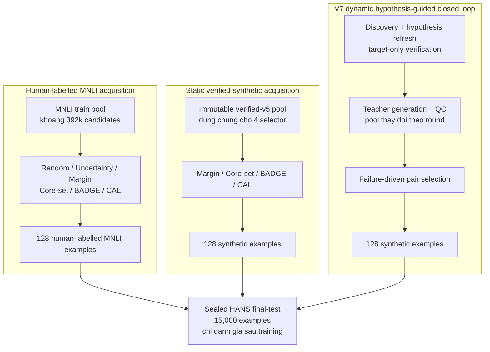

# Bao cao Stage 2 cap nhat — seed 42, budget 128

> **Moc tong hop:** 28/10/2026  
> **Pham vi:** tong hop cac flow cu v2–v7, ablation, cac literature baseline tren verified-synthetic va bon literature baseline moi tren MNLI.  
> **Canh bao thong ke:** tat ca ket qua trong report nay moi chi co mot seed (`seed=42`). Chung phu hop de debug, chon thi nghiem tiep theo va hinh thanh gia thuyet; chua du de ket luan thong ke hoac state-of-the-art.

## 1. Ket luan ngan gon

1. `uncertainty_mnli` van la ket qua cao nhat: **66.9933% HANS**.
2. Trong bon literature baseline MNLI vua hoan thanh, `margin_mnli` tot nhat voi **66.1267%**, tiep theo la `badge_mnli` voi **65.7000%**.
3. V7 continuation dat **65.0000%** khi chi train tren 128 synthetic examples duoc chon boi closed loop dua tren failure hypothesis. V7 khong dung human-labelled MNLI examples lam training data.
4. Khong phai ca bon baseline MNLI moi deu vuot v7: Margin va BADGE vuot ro; Core-set chi hon 20/15,000 mau, nen xem la hoa; CAL thap hon v7.
5. Khong duoc dung bang xep hang chung de ket luan selector MNLI tot hon v7, vi chung khac candidate pool, nguon nhan va quyen truy cap du lieu.
6. Tren static verified-v5 pool, bon published synthetic selector co mot so sanh noi bo duoc kiem soat. Core-set va CAL tot nhat; tuy nhien v7 su dung dynamic closed-loop pool rieng, khong phai chinh static pool nay.

## 2. So do phan biet cac protocol

### 2.1 Dieu gi duoc giu chung

- Student backbone: `Qwen/Qwen3-1.7B`.
- Budget cuoi: 128 training examples.
- LoRA objective chinh: per-example causal-LM cross-entropy tren gold-label tokens.
- Cung frozen HANS final-test manifest va cung 15,000 final examples.
- Final-test chi duoc danh gia mot lan sau training.
- Bon literature MNLI run moi deu `complete`, khong shortage, co 4 optimizer steps, giu AdamW state qua 4 rounds va leakage audit deu pass.
- Bon run moi duoc tao tai git commit `bb781f94c56dd0b95576c4b73c114351e9ee18dc`.

### 2.2 Khac biet quyet dinh cach dien giai

| Nhom | Candidate/training source | Pool behavior | Y nghia so sanh |
|---|---|---|---|
| `*_mnli` | Human-labelled MNLI | Pool lon, co dinh; literature methods re-score gan toan bo pool o rounds 2–4 | Cross-source reference doi voi v7; khong equal-data-access |
| `*_synthetic` | Synthetic candidates tu verified-v5 artifact | Static immutable pool dung chung cho 4 published selectors | So sanh selector tuong doi sach **giua bon published synthetic methods** |
| `ours_verified_v7_continuation` | Synthetic candidates sinh theo failure hypothesis | Dynamic: refresh hypothesis, sinh lai va re-score theo checkpoint moi | Danh gia ca pipeline closed loop; khong tach rieng selector khoi generation/verification |
| `failure_driven_no_verification` | Synthetic, bo verification | One-pass ablation | Dung de do dong gop cua verification, khong phai external baseline |

> **Diem de nham lan:** `margin_synthetic/round_004` va `margin_mnli/round_004` la hai model khac nhau, train tren hai tap 128 examples khac nhau. Chung khong phai checkpoint cu va checkpoint moi cua cung mot run.

## 3. Ket qua literature baseline moi tren MNLI

**Hình 1.** Sealed HANS accuracy được tách thành ba nhóm nguồn dữ liệu. Chỉ nên đọc chênh lệch trong cùng một vùng màu như một so sánh tương đối sạch; chênh lệch giữa các vùng còn trộn ảnh hưởng của nguồn dữ liệu và toàn bộ pipeline.

| Rank trong nhom tham chieu | Method | Training source | HANS overall | HANS entailment | HANS non-entailment | MNLI matched / mismatched | Delta so voi v7 |
|---:|---|---|---:|---:|---:|---:|---:|
| 1 | `uncertainty_mnli` | human MNLI | **66.9933%** | 91.6012% | **42.3000%** | **61.0392% / 61.5439%** | +1.9933 pp |
| 2 | `margin_mnli` | human MNLI | **66.1267%** | 92.2800% | 39.8825% | 60.1325% / 60.6794% | +1.1267 pp |
| 3 | `badge_mnli` | human MNLI | 65.7000% | 92.5196% | 38.7872% | 59.6842% / 60.2116% | +0.7000 pp |
| 4 | `random_mnli` | human MNLI | 65.2600% | 92.7725% | 37.6519% | 59.4906% / 59.7742% | +0.2600 pp |
| 5 | `coreset_mnli` | human MNLI | 65.1333% | 92.8790% | 37.2913% | 59.3989% / 59.6420% | +0.1333 pp |
| 6 | `ours_verified_v7_continuation` | dynamic synthetic | 65.0000% | **93.5711%** | 36.3296% | 58.6347% / 58.9605% | — |
| 7 | `cal_mnli` | human MNLI | 64.7533% | 93.1319% | 36.2762% | 59.0525% / 59.3674% | −0.2467 pp |

### 3.1 Nguon cua chenh lech

Margin va Uncertainty tang HANS overall chu yeu bang cach tang non-entailment accuracy, dong thoi danh doi mot phan entailment accuracy:

- Uncertainty so voi v7: non-entailment `+5.9704 pp`, entailment `−1.9699 pp`.
- Margin so voi v7: non-entailment `+3.5528 pp`, entailment `−1.2911 pp`.
- Core-set so voi v7: non-entailment `+0.9617 pp`, entailment `−0.6921 pp`; net chi +20 correct predictions.
- CAL so voi v7: non-entailment gan nhu bang nhau, nhung entailment thap hon; ket qua overall thap hon 37 predictions.

Do HANS final-test gan can bang entailment/non-entailment, su danh doi tren giai thich phan lon thay doi overall accuracy.

### 3.2 Doi chieu prediction theo tung example

Hai model duoc so sanh tren cung thu tu 15,000 sealed HANS examples. Cot “A dung/B sai” va “A sai/B dung” cho biet hai model sua va lam hong bao nhieu prediction cua nhau.

| A so voi B | A dung / B sai | A sai / B dung | Net correct cua A |
|---|---:|---:|---:|
| Margin so voi Uncertainty | 51 | 181 | −130 |
| Margin so voi Random MNLI | 167 | 37 | +130 |
| Margin so voi BADGE | 82 | 18 | +64 |
| Margin so voi v7 | 266 | 97 | +169 |
| Core-set MNLI so voi v7 | 72 | 52 | +20 |
| CAL MNLI so voi v7 | 31 | 68 | −37 |

Ket qua nay cho thay Margin thang Random/BADGE/v7 co he thong tren fixed test set, con Core-set MNLI va v7 rat gan nhau. No khong giai quyet training-seed variance; van can multi-seed.

## 4. Learning curve cua bon literature MNLI runs

Tat ca bon methods co cung base checkpoint va cung random warm start 32 examples. Rounds 2–4 moi su dung selector rieng. Bang duoi la post-hoc `gain_eval` tren 3,750 examples, khong phai sealed final-test.

**Hình 2.** Margin và BADGE tiếp tục tăng qua các vòng; CAL gần như bão hòa sau budget 64. Đây là cùng một `gain_eval` view nên bốn đường có thể so sánh trực tiếp với nhau.

| Method | Budget 0 | 32 | 64 | 96 | 128 | Gain 0→128 |
|---|---:|---:|---:|---:|---:|---:|
| `margin_mnli` | 62.5067% | 63.0133% | 63.7867% | 64.5067% | **64.9867%** | **+2.4800 pp** |
| `badge_mnli` | 62.5067% | 63.0133% | 63.7600% | 64.2667% | 64.7467% | +2.2400 pp |
| `coreset_mnli` | 62.5067% | 63.0133% | 63.4933% | 63.7600% | 64.1067% | +1.6000 pp |
| `cal_mnli` | 62.5067% | 63.0133% | 63.3867% | 63.4667% | 63.5200% | +1.0133 pp |

Nhan xet:

- Margin tang deu qua ca ba acquisition rounds va co final HANS tot nhat trong bon run moi.
- BADGE cung tang deu, nhung kem Margin tu budget 96 tro di.
- CAL gan nhu bao hoa sau budget 64: hai round cuoi chi tang tong cong `0.1333 pp` tren gain-eval.
- Thu hang gain-eval `Margin > BADGE > Core-set > CAL` trung voi thu hang sealed HANS, lam tang do tin cay cua ket luan noi bo giua bon run nay.

> Khong so sanh truc tiep do cao cua curve nay voi v7 stopping curve: literature curve dung full 3,750-example `gain_eval`, con v7 online curve trong flow document dung predeclared 900-example stopping subset. Chi xu huong curve co the tham khao; sealed HANS final moi la evaluation chung.

## 5. Static verified-synthetic selectors va v7 dynamic flow

### 5.1 Bon published selectors tren cung static pool

Bon hang `*_synthetic` dung chung immutable verified-v5 candidate pool, cung random warm start 32 examples va cung stateful LoRA/AdamW training schedule. Day la phep so sanh selector duoc kiem soat tot nhat hien co.

| Method | HANS overall | HANS non-entailment | MNLI matched / mismatched | Delta so voi random synthetic |
|---|---:|---:|---:|---:|
| `coreset_synthetic` | **65.0533%** | **36.9173%** | 59.0117% / 59.2555% | +0.5933 pp |
| `cal_synthetic` | 65.0333% | 36.8639% | **59.1034% / 59.2962%** | +0.5733 pp |
| `margin_synthetic` | 64.7067% | 35.7420% | 58.5634% / 58.7164% | +0.2467 pp |
| `badge_synthetic` | 64.7000% | 35.7954% | 58.6144% / 58.7673% | +0.2400 pp |
| `random_synthetic` | 64.4600% | 35.1676% | 58.3902% / 58.5130% | — |

Ket luan noi bo: acquisition co tac dung tren static synthetic pool; Core-set va CAL tot nhat tai seed 42.

### 5.2 Tai sao khong duoc goi v7 la “cung pool”

V7 continuation dat **65.0000%**, rat gan Core-set synthetic (+0.0533 pp) va CAL synthetic (+0.0333 pp). Tuy nhien:

- v7 refresh hypothesis theo continuation checkpoint;
- v7 sinh them candidates sau moi refresh;
- candidate pool va hypothesis state co the thay doi qua round;
- published synthetic selectors chi nhin static verified-v5 pool.

Vi vay day la so sanh **cung loai du lieu synthetic, cung budget va evaluator**, nhung khong phai isolation cua selector tren cung exact candidate pool. Ket luan an toan la “v7 canh tranh voi cac published selectors”, khong phai “v7 selector tot hon/hoa tren cung pool”.

## 6. So sanh voi cac verified flow cu

**Hình 3.** Đường xanh biểu diễn progression hợp lệ Zero-shot → v2 CE → v3 CE → v5 CE → v7 continuation. V7 consolidation và no-verification là hai nhánh đối chiếu, không phải hai bước tuần tự của flow chính.

| Flow | HANS | HANS non-entailment | MNLI matched / mismatched | Ghi chu |
|---|---:|---:|---:|---|
| Zero-shot | 63.8533% | 33.7518% | 57.6566% / 57.9434% | Khong training |
| v2 pairwise | 64.3400% | 34.7669% | 58.2476% / 58.4418% | Objective ablation |
| v2 CE | 64.3800% | 34.8204% | 58.2578% / 58.4317% | Objective ablation |
| v3 CE | 64.7533% | 36.1026% | 58.7672% / 58.9402% | Verified flow |
| v5 CE | 64.8200% | 36.4766% | 58.8079% / 58.9402% | Verified flow |
| v7 consolidation | 64.7200% | 35.5817% | 58.4412% / 58.6554% | Fresh one-pass tren 128 v7-selected examples |
| **v7 continuation** | **65.0000%** | 36.3296% | 58.6347% / 58.9605% | Valid online closed-loop branch |
| Failure-driven, no verification | **65.4667%** | **38.3732%** | **59.3377% / 59.6318%** | Ablation; cao hon v7 +0.4667 pp |

Xu huong verified flow la `v2 CE 64.38 → v3 64.7533 → v5 64.82 → v7 continuation 65.00`. V7 la verified run tot nhat, nhung muc tang qua cac version con nho va chua co multi-seed evidence.

Ablation bo verification cao hon v7 70/15,000 predictions. Dieu nay la mot tin hieu can dieu tra: verification co the loc qua chat, lam giam diversity, hoac dan closed loop den mot candidate distribution qua hep. Mot seed khong du de ket luan verification gay hai.

## 7. Chi phi acquisition cua MNLI selectors

Moi literature method MNLI dung random warm start o round 1, sau do score gan toan bo `392,670`, `392,638` va `392,606` candidates o rounds 2–4. Full-pool re-scoring lam acquisition chiem gan nhu toan bo compute.

**Hình 4.** Trade-off HANS–compute tại seed 42. Điểm nằm càng cao và càng về bên trái càng tốt. Uncertainty đang Pareto-dominant so với bốn literature selectors mới, nhưng protocol cũ của nó là one-shot thay vì stateful four-round.

| Method | Acquisition GPU-s | Acquisition GPU-h | Training GPU-s | HANS |
|---|---:|---:|---:|---:|
| `uncertainty_mnli` cũ, one-shot | 30,090.8 | **8.36 h** | 11.8 | **66.9933%** |
| `coreset_mnli` | 38,706.8 | 10.75 h | 23.7 | 65.1333% |
| `margin_mnli` | 137,351.8 | 38.15 h | 17.1 | 66.1267% |
| `cal_mnli` | 145,493.4 | 40.41 h | 15.4 | 64.7533% |
| `badge_mnli` | 156,056.3 | 43.35 h | 14.9 | 65.7000% |

Tai seed 42, Uncertainty co accuracy cao hon va acquisition GPU time thap hon ca bon literature MNLI methods. Tuy nhien Uncertainty cu la one-shot selection/training, con literature methods la four-round stateful protocol. Day la pipeline-level comparison, khong phai selector-only isolation.

Random MNLI co acquisition score cost gan nhu bang 0 va dat 65.2600%; vi vay no van la mot diem chuan quan trong neu muc tieu la cost-effectiveness.

## 8. Bang xep hang tong hop — chi de tham chieu

Bang nay dung chung sealed HANS evaluator, nhung **khong phai bang xep hang cong bang ve selector** do tron nhieu training-data source va protocol.

| Rank | Method | Nhom | HANS | Cach dien giai |
|---:|---|---|---:|---|
| 1 | `uncertainty_mnli` | human MNLI | 66.9933% | Cross-source baseline; ket qua cao nhat |
| 2 | `margin_mnli` | human MNLI | 66.1267% | Literature MNLI tot nhat |
| 3 | `badge_mnli` | human MNLI | 65.7000% | Literature MNLI thu hai |
| 4 | `failure_driven_no_verification` | synthetic ablation | 65.4667% | Khong phai external baseline |
| 5 | `random_mnli` | human MNLI | 65.2600% | One-pass random baseline |
| 6 | `coreset_mnli` | human MNLI | 65.1333% | Hieu dung hoa voi v7 |
| 7 | `coreset_synthetic` | static synthetic | 65.0533% | Tot nhat tren static verified-v5 pool |
| 8 | `cal_synthetic` | static synthetic | 65.0333% | Gan Core-set synthetic |
| 9 | `ours_verified_v7_continuation` | dynamic synthetic | 65.0000% | Verified closed-loop result chinh |
| 10 | `ours_verified_v5_ce` | dynamic synthetic | 64.8200% | Verified flow cu |
| 11 | `ours_verified_target_only_early` | synthetic | 64.7867% | Early target-only protocol |
| 12= | `cal_mnli` | human MNLI | 64.7533% | Thap hon v7 |
| 12= | `ours_verified_v3_ce` | synthetic | 64.7533% | Verified flow cu |
| 14 | `ours_verified_v7_consolidation` | dynamic synthetic | 64.7200% | Fresh replay branch |
| 15 | `margin_synthetic` | static synthetic | 64.7067% | Published selector |
| 16 | `badge_synthetic` | static synthetic | 64.7000% | Published selector |
| 17 | `random_synthetic` | synthetic | 64.4600% | Synthetic baseline |
| 18 | `ours_verified_v2_ce` | synthetic | 64.3800% | Objective ablation |
| 19 | `ours_verified_v2_pairwise` | synthetic | 64.3400% | Objective ablation |
| 20 | `zero_shot` | reference | 63.8533% | Khong training |

`ours_verified_v6_closed_loop` khong duoc xep hang vi checkpoint continuity audit failed. Strict initial verified run abstain va tra ve zero-shot fallback.

## 9. Claim co the va khong the dua vao bai bao

### 9.1 Claim hien tai co the bao ve

> At seed 42 and a 128-example training budget, the hypothesis-guided v7 closed loop reaches 65.00% sealed HANS accuracy without using human-labelled MNLI examples as training data. It is competitive with published acquisition functions applied to a reusable verified-synthetic pool. Human-labelled MNLI acquisition provides stronger cross-source baselines, with uncertainty sampling and Margin reaching 66.99% and 66.13%, respectively; these results are not equal-data-access comparisons with v7.

Ban tieng Viet:

> Tai seed 42 va budget 128, v7 hypothesis-guided closed loop dat 65.00% sealed HANS ma khong dung human-labelled MNLI examples lam training data. Ket qua nay canh tranh voi cac published acquisition functions tren verified-synthetic data. Khi duoc truy cap human-labelled MNLI pool, Uncertainty va Margin dat 66.99% va 66.13%; day la cross-source baselines, khong phai equal-data-access comparison voi v7.

### 9.2 Khong nen claim

- Khong claim v7 co accuracy cao nhat: Uncertainty, Margin, BADGE va no-verification ablation dang cao hon tai seed 42.
- Khong claim v7 dung it human information hon mot cach tuyet doi: flow van dung cac HANS role cho discovery/verification va dung teacher 14B de sinh synthetic data.
- Khong claim Core-set/CAL va v7 chay tren cung exact pool. Chi bon `*_synthetic` literature methods chia se static verified-v5 pool voi nhau.
- Khong claim v7 re hon end-to-end: evaluation schedule va teacher/pool-construction cost chua duoc can bang.
- Khong claim significance hoac generalization tu mot seed.
- Khong dung MNLI matched accuracy tren truc bieu do de suy ra model da train MNLI; voi synthetic methods, MNLI chi la evaluation view.

## 10. Thi nghiem tiep theo de khoa ket luan

Uu tien theo thu tu:

1. Chay seeds 43 va 44 cho `uncertainty_mnli`, `margin_mnli`, `badge_mnli`, `random_mnli` va v7 continuation.
2. Them `random_mnli` theo dung four-round stateful schedule de tach selector effect khoi training-schedule effect.
3. Consolidate tren dung 128 IDs do Margin/Uncertainty chon de so sanh online continuation voi fresh one-pass training.
4. Neu muc tieu la isolation selector, cho v7 selector va published selectors chay tren cung frozen candidate trace; neu muc tieu la full-system comparison, giu dynamic v7 nhung ghi ro pipeline-level comparison.
5. Bao cao mean ± standard deviation va paired seed deltas; khong dung test-example uncertainty thay cho training-seed uncertainty.
6. Tach cost thanh pool construction, teacher generation, verification, acquisition scoring, training, evaluation, wall time va peak VRAM.

## 11. Nguon artefact

### Literature MNLI moi

- `outputs/stage2_runs_literature/experiment_b/margin_mnli/budget_128/seed_42/result.json`
- `outputs/stage2_runs_literature/experiment_b/coreset_mnli/budget_128/seed_42/result.json`
- `outputs/stage2_runs_literature/experiment_b/badge_mnli/budget_128/seed_42/result.json`
- `outputs/stage2_runs_literature/experiment_b/cal_mnli/budget_128/seed_42/result.json`

### Cac diem chuan chinh

- `outputs/stage2_runs/experiment_a/uncertainty_mnli/budget_128/seed_42/result.json`
- `outputs/stage2_runs/experiment_a/random_mnli/budget_128/seed_42/result.json`
- `outputs/stage2_runs/experiment_a/random_synthetic/budget_128/seed_42/result.json`
- `outputs/stage2_runs/experiment_a/failure_driven_no_verification/budget_128/seed_42/result.json`
- `outputs/stage2_runs_ours_verified_v7_dual/experiment_b/ours_verified/budget_128/seed_42/branches/continuation/result.json`
- `outputs/stage2_runs_ours_verified_v7_dual/experiment_b/ours_verified/budget_128/seed_42/branches/consolidation/result.json`

### Luu y ve report cu

`Report_211026.md` duoc tao truoc khi bon MNLI literature runs hoan thanh va con ghi chung la pending. Lenh vua chay co `--no-report`, nen file cu khong tu dong cap nhat. Report hien tai thay the phan dien giai pending do, nhung khong ghi de report cu de bao toan dau vet thoi gian.

---

## Final takeaway

V7 khong thang tuyet doi ve accuracy, nhung dat khoang 65% HANS bang 128 targeted synthetic examples va khong train tren human-labelled MNLI examples. Cac baseline truy cap full human-labelled MNLI pool chi hon tu `−0.25` den `+1.99` percentage points tuy selector. Gia tri chinh cua v7 hien tai nam o kha nang tao du lieu co muc tieu, hypothesis certification va closed-loop auditability; accuracy advantage van chua duoc chung minh. Ket luan nay can duoc xac nhan tren nhieu seed truoc khi dua thanh claim chinh cua bai bao.
